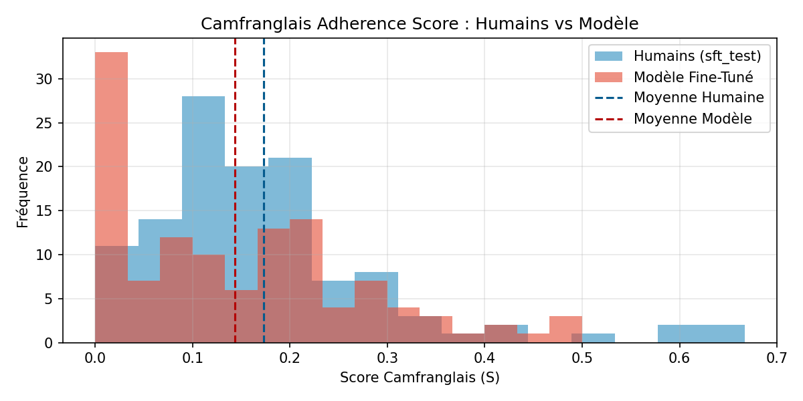

Large language models excel at high-resource languages like English and standard French, yet they quickly break down when confronted with regional creoles and urban contact languages. **Camfranglais** is a prime example: spoken daily across Cameroon, it weaves together a French grammatical structure with vocabulary drawn from English, French and Cameroonian Pidgin.

When prompted to speak Camfranglais out of the box, models like `Mistral-Nemo-Instruct-2407` either fall back to textbook French or invent caricatured expressions that no Cameroonian speaker would ever use. In this article, I walk through how I built **CameroonianAI**, an end-to-end data curation and hybrid fine-tuning pipeline that adapts a 12-billion-parameter model to authentic Camfranglais.

The resulting LoRA adapters, quantized `Q4_K_M` GGUF weights, and curated corpora are publicly available:
- **Model Repository:** [huggingface.co/Cmr237/Camfranglais](https://huggingface.co/Cmr237/Camfranglais)
- **CPT Dataset:** [huggingface.co/datasets/Cmr237/camfranglais-corpus-cpt](https://huggingface.co/datasets/Cmr237/camfranglais-corpus-cpt)
- **SFT Dataset:** [huggingface.co/datasets/Cmr237/camfranglais-corpus-sft](https://huggingface.co/datasets/Cmr237/camfranglais-corpus-sft)
- **Source Code:** [github.com/SodaiCMR/CameroonianAI](https://github.com/SodaiCMR/CameroonianAI)

---

## 1. The Data Challenge: Isolating Camfranglais from 111,064 Raw Comments

No public conversational dataset existed for Camfranglais. The most authentic written traces of the language live in online discussions around Cameroonian music, comedy, and daily life. Using the YouTube Data API v3 in `src/data_pipeline/scraper.py`, I collected **111,064 comments** across Cameroonian channels, separating standalone comments from **12,000 parent-to-child reply threads**.

Raw comment sections, however, are noisy. A single video thread mixes standard French, pure English, and anglophone Cameroonian Pidgin. Training directly on unfiltered comments would dilute the target dialect.

To separate genuine Camfranglais from neighboring languages, I compiled a structured lexicon in `config/lexicon.json` derived from Wiktionary's Camfranglais annex, categorizing **486 strong markers** exclusive to Camfranglais and **159 medium markers** shared with colloquial speech, alongside lists of French and Pidgin syntactic anchors.

### Mathematical Formulation of the Linguistic Score $S$

Every candidate text of $N$ words is evaluated by `src/data_pipeline/scorer.py` using a three-factor scoring function:

$$
S = \mathbb{I}(N \ge 6) \times D_{\text{cam}} \times P_{\text{matrice}}
$$

#### 1. Length Gate $\mathbb{I}(N \ge 6)$
Comments shorter than six words are discarded so the model only trains on complete clauses rather than isolated interjections.

#### 2. Weighted Lexical Density $D_{\text{cam}}$
Each word receives a weight $w_i = 2.0$ if it matches a strong marker and $w_i = 1.0$ if it matches a medium marker:

$$
D_{\text{cam}} = \frac{1}{N} \sum_{i=1}^{N} w_i
$$

Because Camfranglais has no standardized orthography, exact string lookups miss common inflections and phonetic spellings. For words of four characters or more, the scorer applies fuzzy matching against lexicon roots using `SequenceMatcher` with a similarity threshold of `0.84`:

```python
def get_word_camfranglais_weight(word: str, lexicon: Dict) -> float:
    w_strong = lexicon.get("strong_markers_weight", 2.0)
    w_medium = lexicon.get("medium_markers_weight", 1.0)
    strong_set = set(m.strip().lower() for m in lexicon["strong_markers"])
    medium_set = set(m.strip().lower() for m in lexicon["medium_markers"])
    french_set = set(m.strip().lower() for m in lexicon["french_anchors"])

    if word in french_set:
        return 0.0
    if word in strong_set:
        return w_strong
    if word in medium_set:
        return w_medium

    if len(word) >= 4:
        for root in strong_set:
            if len(root) >= 4 and (root in word or SequenceMatcher(None, word, root).ratio() >= 0.84):
                return w_strong
        for root in medium_set:
            if len(root) >= 4 and (root in word or SequenceMatcher(None, word, root).ratio() >= 0.84):
                return w_medium
    return 0.0
```

#### 3. Syntactic Matrix Factor $P_{\text{matrice}}$
Unlike pure Pidgin English, Camfranglais embeds its lexicon inside a French grammatical matrix. To enforce this structural property, $P_{\text{matrice}}$ computes the ratio of French function words $C_{\text{fr}}$ to English and Pidgin function words $C_{\text{en/pid}}$:

$$
P_{\text{matrice}} = \frac{C_{\text{fr}}}{C_{\text{fr}} + C_{\text{en/pid}} + \epsilon}
$$

Sentences written entirely in English or pure Pidgin drive $P_{\text{matrice}}$ toward zero and are automatically filtered out, even if they share borrowed nouns with Camfranglais.

### Asymmetric Filtering for Conversational Threads

A key design choice in `filter_sft_conversations` concerns how parent-to-child threads are filtered into user-assistant dialogues. Rather than requiring both messages to score above the threshold $\tau_{\text{haut}} = 0.06$, only the child reply is constrained to score in the high zone, while the parent message simply requires at least three words:

```python
if len(user_words) >= 3 and res_assistant["score"] >= threshold:
    valid_conversations.append({
        "conversations": [
            {"role": "user", "content": clean_user},
            {"role": "assistant", "content": res_assistant["cleaned_text"]}
        ]
    })
```

This asymmetry is deliberate: in real usage, a user might ask a question in standard French or in Camfranglais, and the assistant should respond naturally in Camfranglais in both cases.

After deduplication and filtering, the pipeline produced **14,302 unstructured texts** for pre-training and **1,200 dialogue pairs** split into 1,080 training dialogues and 120 test dialogues.

---

## 2. Why Hybrid Training Beats Single-Stage SFT

When adapting a foundation model to a new dialect, relying solely on Supervised Fine-Tuning or solely on Continued Pre-Training creates a trade-off:

- **Continued Pre-Training alone** exposes the model to thousands of authentic expressions, but overwrites its instruction-following behavior. Prompted with a question, a CPT-only model continues generating YouTube-style commentary rather than answering the user.
- **Supervised Fine-Tuning alone** preserves the `[INST] ... [/INST]` conversational structure, but 1,080 dialogues are too few for a 12B model to internalize hundreds of new lexical items and syntactic turns.

To get the best of both worlds, I trained a single set of QLoRA adapters across two consecutive phases on an NVIDIA L4 GPU with 22.5 GB of VRAM:

1. **Phase 1 — Continued Pre-Training on 14,302 texts:**
   Trained with rank $r = 32$, $\alpha = 32$, `use_rslora = True`, and a learning rate of $10^{-4}$. Here, the 114 million trainable parameters absorb Cameroonian vocabulary, idioms, and code-switching patterns through standard causal language modeling.
2. **Phase 2 — Supervised Fine-Tuning on 1,080 dialogues:**
   Starting directly from the Phase 1 adapters, the learning rate is lowered to $5 \times 10^{-5}$ and loss computation is masked on user prompts via `train_on_responses_only`. This second pass aligns the newly acquired linguistic knowledge with conversational turn-taking.

---

## 3. Quantitative Evaluation on Held-Out Dialogues

Evaluating a model on a low-resource spoken vernacular cannot rely on standard English benchmarks. I designed a three-part evaluation suite in `src/data_pipeline/evaluator.py` computed over the 120 unseen test dialogues.

### 1. Perplexity and Fluency
Doubling the CPT corpus and refining the Wiktionary lexicon reduced the test cross-entropy loss to `3.1847`, bringing test perplexity down from `29.68` on the initial run to **`24.16`**.

### 2. Linguistic Adherence Distribution
By running the linguistic scorer $S$ on both the model's generated replies and the ground-truth human replies across the 120 test prompts, we can compare how naturally the model doses its slang:

- **Human reference mean score $S$:** `0.1731` with standard deviation `0.1286`
- **Fine-tuned model mean score $S$:** `0.1435` with standard deviation `0.1283`
- **Mean absolute gap:** `0.0297`
- **Active Camfranglais rate:** **`73.33%`** of generated answers contain verified Camfranglais markers



As shown in the histogram above, the model does not artificially stuff every word with slang. Between $S = 0.10$ and $S = 0.50$, its density curve closely tracks human speakers, peaking around $S = 0.20$ — the natural cadence of a French sentence enriched with one to three Camfranglais expressions.

### 3. Multilingual Semantic Relevance
To verify that replies remain on-topic rather than merely emitting random Cameroonian slang, generated answers and human references are embedded with `sentence-transformers/paraphrase-multilingual-MiniLM-L12-v2`:

- **Mean cosine similarity to user prompt:** `0.3968`, reaching up to `0.9074`
- **Mean cosine similarity to human reference:** `0.3382`, reaching up to `0.8275`

---

## Conclusion

Separating linguistic acquisition from dialogue alignment makes it possible to teach a 12B language model a low-resource regional vernacular on a single L4 GPU. By combining a mathematically grounded filtering formula over raw social media threads with a two-stage CPT-to-SFT QLoRA schedule, **CameroonianAI** captures the authentic rhythm of Camfranglais while remaining a coherent conversational assistant.
