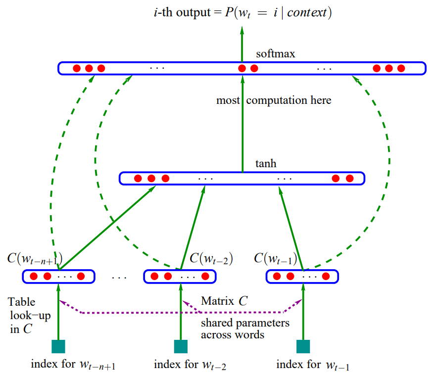
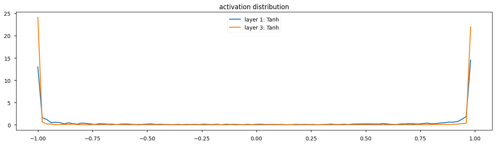
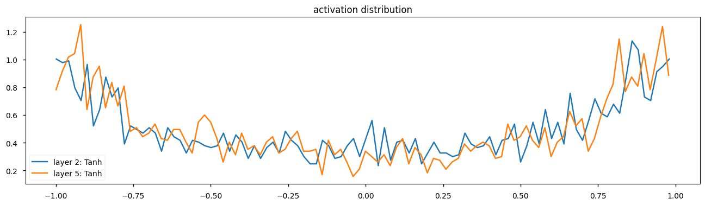

Here I implemented an MLP from scratch where **the goal was to be able to generate fictional character names from a Japanese's dataset**. The full code is available in this [GitHub repo](https://github.com/darylbdr/AI-Sandbox/blob/main/MLP/MLP_from_scratch.ipynb).

I followed the approach introduced in the [Bengio et al. 2003 MLP language model paper](https://www.jmlr.org/papers/volume3/bengio03a/bengio03a.pdf) where the MLP architecture proposed in the paper is the following:



It is composed of three layers:
- [The Input Embedding Layer](#the-input-embedding-layer)
- [The TanH Layer](#the-tanh-layer)
- [The Softmax Layer](#the-softmax-layer)

---

## The Input Embedding Layer

In Bengio et al.'s paper, the input layer receives a context window of $n$ previous tokens and maps each of them into a continuous embedding space. Before feeding sequence data into the neural network, we must preprocess the raw text so that it matches the shape and format expected by the embedding layer.
Particularly in this case, I used a context window of 6 because in the dataset, the average character length of a name was `6.54`.
### Data Preprocessing

#### 1. Building the vocabulary
Since this implementation operates at the character level, the vocabulary is composed of every unique character present in the dataset (letters, spaces, hyphens, etc.).

```python
# Extract all unique characters from the dataset
vocab = sorted(set(list(''.join(names))))
# The vocab looks like this: [' ', '-', 'a', 'b', 'c', 'd', 'e', 'f', 'g', '...z']
```

#### 2. Creating Token Mappings (String ↔ Integer)
Neural networks cannot process raw strings directly, so we map each character to a unique integer index:

```python
# Map characters to unique integer indices
char_to_idx = {char: idx + 1 for idx, char in enumerate(vocab[2:])}
char_to_idx.update({'.': 0, '-': 27, ' ': 28})
# Reverse mapping: indices back to characters
idx_to_char = {idx: char for char, idx in char_to_idx.items()}
```

The `.` character is the special token which serves as the end-of-sequence token. I mapped it to `0` as a convention and to make it easier to mask.

#### 3. Constructing the N-gram Dataset
To train the model, we use a sliding window mechanism. For each target character we want to predict, we collect the preceding $n$ characters as context.

```python
# Context window setup example
context = [0] * context_length  # Padded context
for ch in name + '.':
    X.append(context)
    idx = char_to_idx[ch]
    Y.append(idx)
    context = context[1:] + [idx]  # Slide window
```

For instance, for a context length of 3, the dataset function generates the following input-target pairs:

```text
[. . .] -> n
[. . n] -> a
[. n a] -> m
[n a m] -> e
[a m e] -> .
```

#### 4. Embedding Lookup Table
Once the context indices are prepared, each character index is mapped into a continuous vector space using an embedding matrix:

$$
C \in \mathbb{R}^{\text{vocab\_size} \times n_{\text{emb}}}
$$

In PyTorch, indexing $C$ with $X$ performs a fast lookup without needing matrix multiplication with one-hot vectors:

```python
# Embedding matrix initialization
n_emb = 2  # Dimensionality of the character embedding space
C = torch.randn((vocab_size, n_emb), generator=gen)

emb = C[X]
```

#### 5. Concatenating Context Embeddings
Before feeding the data to the hidden layer, the $n$ context character vectors must be concatenated into a single feature vector of dimension $n_{\text{emb}} \times \text{context\_length}$. Instead of using `torch.cat` (which allocates new memory), we can efficiently reshape the tensor view using PyTorch's `.view()` method:

```python
# Flatten context vectors: (num_samples, context_length * n_emb)
emb_cat = emb.view(emb.shape[0], -1)
```

---

## The TanH Layer

Once we have concatenated the context embeddings into a single vector $x \in \mathbb{R}^{n_{\text{emb}} \cdot \text{context\_length}}$, we feed it into the hidden layer.

### 1. Linear Transformation & Pre-activation
The linear layer projects the input embedding vector into a higher-dimensional hidden space $n_{\text{hidden}}$:

$$
h_{\text{preact}} = x W_1 + b_1
$$

Where:
- $W_1 \in \mathbb{R}^{(n_{\text{emb}} \cdot \text{context\_length}) \times n_{\text{hidden}}}$ represents the weight matrix.
- $b_1 \in \mathbb{R}^{n_{\text{hidden}}}$ is the bias vector.

### 2. Activation Function ($\tanh$) and Saturation

The pre-activation vector passes through a non-linear activation function, $\tanh$:

$$
h = \tanh(h_{\text{preact}})
$$

The $\tanh$ function squashes input values into the range $[-1, 1]$. However, if the pre-activations $h_{\text{preact}}$ take very large positive or negative values, $\tanh$ saturates:

$$
\frac{d}{dx}\tanh(x) = 1 - \tanh^2(x) \approx 0 \quad \text{when } \lvert x \rvert \gg 0
$$

When activations saturate, their gradients vanish during backpropagation, stopping the network from learning effectively.



### 3. Weight Initialization (Kaiming Init)

According to the [Kaiming initialization paper](https://arxiv.org/pdf/1502.01852), in order to prevent pre-activations from taking extreme values at initialization, we scale the weight matrix $W_1$. For a $\tanh$ activation, Kaiming initialization prescribes scaling standard normal weights by a gain factor divided by the square root of the fan-in (number of input units):

$$
\text{std} = \frac{\text{gain}}{\sqrt{\text{fan\_in}}} = \frac{5/3}{\sqrt{n_{\text{emb}} \cdot \text{context\_length}}}
$$



As we can see on the graph, the distribution is balanced and there are far fewer saturated values.

### 4. Batch Normalization Layer

Even though this was not mentioned in the [Bengio et al. 2003 MLP language model paper](https://www.jmlr.org/papers/volume3/bengio03a/bengio03a.pdf), I added a Batch Normalization layer.
Introduced by [Ioffe & Szegedy, 2015](https://arxiv.org/pdf/1502.03167), Batch Normalization makes the training of deep neural networks less sensitive to initial weight scaling and stabilizes activation distributions across layers.

#### Mathematical Formulation
For a mini-batch $B$ of size $m$, we compute the batch mean $\mu_B$ and batch standard deviation $\sigma_B$ for each feature:

$$
\mu_B = \frac{1}{m} \sum_{i=1}^{m} x_i
$$

$$
\sigma_B = \sqrt{\frac{1}{m} \sum_{i=1}^{m} (x_i - \mu_B)^2 + \epsilon}
$$

The pre-activations are normalized and transformed using two learnable parameters per feature: $\gamma$ (gain, initialized to ones) and $\beta$ (bias, initialized to zeros):

$$
\hat{x}_i = \frac{x_i - \mu_B}{\sigma_B}
$$

$$
y_i = \gamma \odot \hat{x}_i + \beta
$$

During training, normalization relies on the current mini-batch statistics. However, during inference, we often predict one sample at a time ($m = 1$), making batch mean and variance undefined. To solve this, we maintain an exponentially weighted moving average of the mean and standard deviation during training:

$$
\mu_{\text{running}} = (1 - \eta) \cdot \mu_{\text{running}} + \eta \cdot \mu_B
$$

$$
\sigma_{\text{running}} = (1 - \eta) \cdot \sigma_{\text{running}} + \eta \cdot \sigma_B
$$

where $\eta$ is the momentum factor (e.g., $0.001$).

#### Implementation
```python
# Parameters initialization
bn_gain = torch.ones((1, n_hidden))
bn_bias = torch.zeros((1, n_hidden))

bn_mean_running = torch.zeros((1, n_hidden))
bn_std_running = torch.zeros((1, n_hidden))

# Forward pass (Training)
bn_meani = h_preact.mean(0, keepdim=True)
bn_stdi = h_preact.std(0, keepdim=True)

# Standardize and scale
h_preact = bn_gain * (h_preact - bn_meani) / bn_stdi + bn_bias

# Update running statistics out of the autograd graph
with torch.no_grad():
    bn_mean_running = 0.999 * bn_mean_running + 0.001 * bn_meani
    bn_std_running = 0.999 * bn_std_running + 0.001 * bn_stdi
```

Notice that when using Batch Normalization right after a linear layer, the linear layer's bias $b_1$ becomes redundant because $\mu_B$ gets subtracted during normalization. Thus, $b_1$ can be safely omitted, leaving $\beta$ to handle the offset.

---

## The Softmax Layer

After passing through the hidden layer (and Batch Normalization), the hidden representations $h \in \mathbb{R}^{n_{\text{hidden}}}$ are mapped to the output vocabulary space to predict the probability of the next character.
The output linear layer projects the hidden vector $h$ into unnormalized log-probabilities (logits) $z \in \mathbb{R}^{\text{vocab\_size}}$:

$$
z = h W_2 + b_2
$$

Where $W_2 \in \mathbb{R}^{n_{\text{hidden}} \times \text{vocab\_size}}$ and $b_2 \in \mathbb{R}^{\text{vocab\_size}}$.
To convert logits into a valid probability distribution over all characters in the vocabulary $V$, we apply the Softmax function:

$$
P(Y = k \mid x) = \frac{e^{z_k}}{\sum_{j=1}^{\lvert V \rvert} e^{z_j}}
$$

### Fixing Initial Loss
At step 0 of training with standard normal initialization, logits $z$ can take arbitrarily large values. This causes the network to be confidently wrong on many samples, resulting in an artificially high initial loss (e.g., $\mathcal{L}_0 \approx 27.0$). Ideally, at initialization, the model should assign equal probability to every character in the vocabulary:

$$
P_{\text{expected}} = \frac{1}{\lvert V \rvert}
$$

For a vocabulary size $\lvert V \rvert = 29$, the expected initial loss is:

$$
\mathcal{L}_{\text{expected}} = -\log\left(\frac{1}{29}\right) \approx 3.36
$$

To achieve this and avoid wasting training steps fixing poor initial weights, we squash $W_2$ near zero and initialize $b_2$ to zero:

```python
w2 = torch.randn((n_hidden, vocab_size), generator=gen) * 0.01
b2 = torch.zeros(vocab_size)
```

# Inference

I finally proceeded to sample some names from the model and got the following:
```
ciko paoxin
ollio
kou
aist
ouishi
hiho
ettaa
iko
hlopeman
ana
```

I only used a dataset of 133939 examples and a model with 22K parameters so the results aren't the best, but still some examples are acceptable.