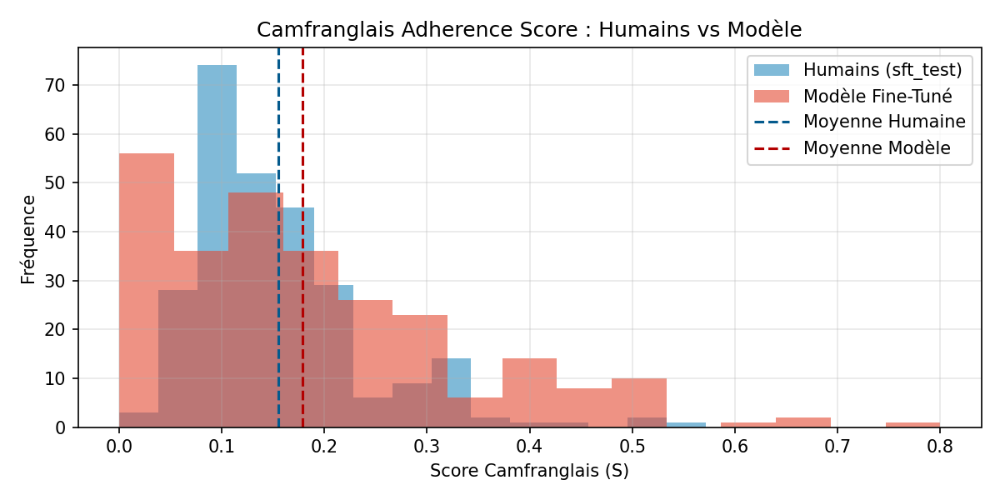

## Overview

**CameroonianLLM** adapts the 12-billion-parameter `Mistral-Nemo-Instruct-2407` model to **Camfranglais**, a contact language born in Cameroon that blends French syntax with English, Cameroonian Pidgin, and local languages such as Duala, Ewondo, and Bamileke.

Standard large language models fail on low-resource urban vernaculars because they either revert to formal academic French or hallucinate incoherent slang. To solve this, our team built an end-to-end data collection, linguistic filtering, and two-stage hybrid fine-tuning pipeline that separates vocabulary acquisition from conversational instruction following.

- **Hugging Face Model & GGUF Weights:** [huggingface.co/Cmr237/Camfranglais](https://huggingface.co/Cmr237/Camfranglais)
- **CPT Corpus — 23,224 texts:** [huggingface.co/datasets/Cmr237/camfranglais-corpus-cpt](https://huggingface.co/datasets/Cmr237/camfranglais-corpus-cpt)
- **SFT Corpus — 2,671 dialogues:** [huggingface.co/datasets/Cmr237/camfranglais-corpus-sft](https://huggingface.co/datasets/Cmr237/camfranglais-corpus-sft)
- **GitHub Repository:** [github.com/SodaiCMR/CameroonianAI](https://github.com/SodaiCMR/CameroonianAI)

---

## End-to-End Pipeline Architecture

Data ingestion, pseudonymization, linguistic filtering, dataset assembly, and evaluation run locally on CPU via modular Python scripts in `src/data_pipeline/`, while QLoRA training executes on an NVIDIA L4 GPU with 22.5 GB of VRAM.

```text
+-------------------------------------------------------------------------+
|                        Local CPU Data Pipeline                          |
|                                                                         |
|  1. Multi-Source Ingestion (scraper.py, whatsapp.py, conv.json)         |
|     163,283 YouTube comments, pseudonymized WhatsApp chats & greetings  |
|                                  |                                      |
|                                  v                                      |
|  2. Linguistic Scorer S (src/data_pipeline/scorer.py)                   |
|     Scores texts using 480 Wiktionary markers and French syntax anchors |
|                                  |                                      |
|                                  v                                      |
|  3. Dataset Builder (src/data_pipeline/builder.py)                      |
|     23,224 CPT texts  |  2,404 SFT train dialogues  |  267 test         |
+-------------------------------------------------------------------------+
                                   |
                                   | Push to Hugging Face Hub
                                   v
+-------------------------------------------------------------------------+
|                    NVIDIA L4 GPU Training Pipeline                      |
|                                                                         |
|  Phase 1: Continued Pre-Training (CPT) at lr = 1e-4                     |
|           Assimilates Cameroonian vocabulary, idioms, and syntax        |
|                                  |                                      |
|                                  v                                      |
|  Phase 2: Supervised Fine-Tuning (SFT) at lr = 5e-5                     |
|           Structures assistant replies using [INST] ... [/INST]         |
+-------------------------------------------------------------------------+
                                   |
                                   v
         Published LoRA Adapters & GGUF Q4_K_M on Hugging Face
```

---

## Linguistic Filtering and Mathematical Scoring

Scraping Cameroonian YouTube channels and aggregating WhatsApp exports yields a noisy mix of standard French, pure English, and Nigerian or Cameroonian Pidgin. To isolate authentic Camfranglais without penalizing longer sentences, `src/data_pipeline/scorer.py` evaluates every text of $N$ words using a composite score $S$:

$$
S = \mathbb{I}(N \ge 6) \times D_{\text{cam}} \times P_{\text{matrice}}
$$

1. **Minimum Length Indicator $\mathbb{I}(N \ge 6)$:** Discards short reactions that carry no syntactic structure.
2. **Weighted Lexical Density $D_{\text{cam}}$:**
   $$
   D_{\text{cam}} = \frac{1}{N} \sum_{i=1}^{N} w_i
   $$
   Built from the Wiktionary Camfranglais lexicon in `config/lexicon.json`, assigning a weight $w_i = 2.0$ to 321 exclusive Camfranglais markers and $w_i = 1.0$ to 159 secondary markers, with fuzzy root matching via `SequenceMatcher` at a 0.84 ratio threshold to handle spelling variations.
3. **Syntactic Matrix Ratio $P_{\text{matrice}}$:**
   $$
   P_{\text{matrice}} = \frac{C_{\text{fr}}}{C_{\text{fr}} + C_{\text{en/pid}} + \epsilon}
   $$
   Measures the proportion of French function words relative to English and Pidgin anchors, ensuring that retained sentences preserve a Franco-Cameroonian grammatical backbone.

When building SFT conversation pairs from `Parent -> Child` comment threads and WhatsApp exchanges, only the assistant reply must exceed the high-confidence threshold $\tau_{\text{haut}} = 0.06$. Allowing the user prompt to remain in standard French or Camfranglais teaches the model to respond naturally in Camfranglais regardless of how the user phrases their prompt.

---

## Two-Stage Hybrid Training: CPT Followed by SFT

Training relies on rank-stabilized QLoRA in `bfloat16` precision with rank $r = 32$, $\alpha = 32$, and `use_rslora = True`, updating 114 million trainable parameters representing 0.92% of the 12B backbone:

| Stage | Dataset | Learning Rate | Objective |
| :--- | :--- | :---: | :--- |
| **Phase 1: Continued Pre-Training** | 23,224 raw texts | `1e-4` | Learn Cameroonian vocabulary, spelling variations, and idioms through next-token prediction. |
| **Phase 2: Supervised Fine-Tuning** | 2,404 dialogues | `5e-5` | Shape the same LoRA adapters into a helpful conversational assistant using `train_on_responses_only`. |

Using CPT alone causes the model to behave like an unprompted comment or message thread, whereas SFT alone lacks lexical depth. Chaining both phases on the same adapters combines rich vernacular expression with reliable instruction following.

---

## Evaluation Results on the 267-Dialogue Test Set

The model was evaluated across three complementary axes in `src/data_pipeline/evaluator.py`: fluency via perplexity, linguistic fidelity via the adherence score $S$, and semantic relevance via multilingual sentence embeddings using `paraphrase-multilingual-MiniLM-L12-v2`.

| Category | Metric | Value | Analysis |
| :--- | :--- | :---: | :--- |
| **Fluency** | Eval Loss | `3.7362` | Cross-entropy loss across the 267 held-out test dialogues, including freer real-world WhatsApp pairs. |
| **Fluency** | Perplexity | **`41.94`** | Measured across the full 267-dialogue evaluation split. |
| **Camfranglais Adherence** | Model Mean Score $S$ | **`0.1789`** | Closely matches the human reference mean of `0.1551`, with a mean absolute gap of only `0.0237`. |
| **Camfranglais Adherence** | Active Camfranglais Rate | **`81.27%`** | Over four-fifths of generated replies actively incorporate verified lexicon markers. |
| **Semantic Relevance** | Prompt Cosine Similarity | **`0.3891`** | Strong topical alignment with user questions, reaching up to `0.8810`. |
| **Semantic Relevance** | Reference Cosine Similarity | **`0.3309`** | Semantic proximity to ground-truth human replies, reaching up to `0.7615`. |



Across the 267 test dialogues, the fine-tuned model closely mirrors the human score distribution, with 81.27% of generated replies actively incorporating verified Camfranglais markers and only 18.73% falling at $S = 0.0$ in standard French.
